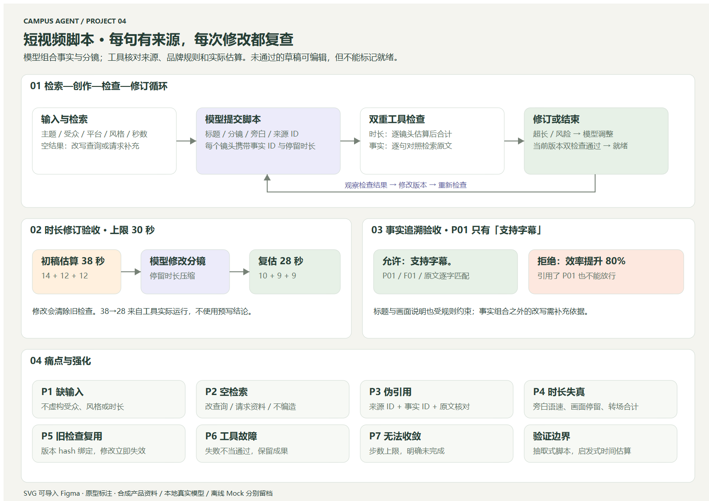

# 题目 4：短视频脚本 Agent

## 固定版本交付（2026-11-07）

[设计说明](docs/submission/01-design.md) · [提交与考官验收指南](docs/submission/02-delivery-and-acceptance.md) · [干净源码包检查](examples/submission/preflight.json)。固定标签 `q4-submission-20261107`；公开仓库和本机Ollama均无需评审密钥。完整提交SHA以该标签指向commit为准。


从检索到的产品事实生成可编辑分镜，检查时长与品牌规则，依据真实检查结果修订后复查。真实模型选择动作，工具核验事实；离线 Mock 单独标记。

Python 3.10+ 标准库、SQLite、本地 Ollama Qwen，提供 CLI 和本地 Web 工作台。没有真实视频制作或发布。

## 评审入口

- [本轮边缘与困难场景修复](docs/09-hardening-round.md)：修复前失败、原因、修复后回归与真实模型补测。

- [需求与事实边界](docs/01-requirements.md)、[调用流程和技术取舍](docs/02-solution.md)。
- [实际评估与失败记录](docs/03-evaluation.md)、[AI 辅助范围](docs/04-ai-usage.md)、[复盘](docs/05-retrospective.md)。
- [可导入 Figma 的 SVG](docs/prototypes/script-flow.svg)、[痛点强化](docs/06-prototype-and-hardening.md)。
- [使用手册](docs/07-user-manual.md)、[分层稳健性](docs/08-robustness.md)。
- [最终验收汇总](examples/acceptance.json)、[离线实际输入/输出/Trace](examples/mock/)、[真实模型运行记录](examples/real/)、[空库真实复测](examples/real-empty-retest/)、[Python 测试](examples/tests/report.json)、[浏览器检查](examples/browser/report.json)、[真实网页联调](examples/browser-real/report.json)。



## 安装与网页运行

运行时仅需 Python 3.10+ 标准库，无第三方 Python 依赖。Windows 实测 Python 3.10.11，CI 检查 Python 3.10/3.12。Node.js 22+ 仅用于浏览器测试。没有使用 Agent 框架；原生循环与工具守卫便于评审逐步检查。

```powershell
git clone https://github.com/ttk-maker/campus-agent-q4-video-script.git
cd campus-agent-q4-video-script
py -3.10 -m src.web
```

打开 **http://127.0.0.1:8769/**，手册 **http://127.0.0.1:8769/manual.html**。Linux/macOS 将 `py -3.10` 替换为 `python3`。可用 `--port` 和 `--db` 改端口/数据库。默认本机 SQLite 为 `runtime/workbench.db`。

`http://localhost:11434/v1` 是模型 API 前缀，直接浏览可能404；网页在8769。GitHub 托管源码，不等于线上应用。

## CLI 离线与真实运行

```powershell
# 新建含38秒待修订初稿的案例
py -3.10 -m scripts.make_request --scenario over_duration
py -3.10 -m src.cli --request runtime/request/input.json --catalog runtime/request/catalog.json --db runtime/offline.db --mode mock
```

默认写入 `runtime/output.json`、`runtime/trace.jsonl`，可用 `--output` / `--trace` 修改。完成退出0，其余终态退出2。没有初稿的生成案例使用 `--scenario normal`；工具失败、无素材等选择见 `python -m scripts.make_request --help`。

真实模式使用本机已有 Ollama `qwen2.5:7b-instruct`（7B Q4_K_M），本地无需密钥。先安装并启动 Ollama，再运行：

```powershell
ollama pull qwen2.5:7b-instruct
$env:MODEL_BASE_URL='http://localhost:11434/v1'
$env:MODEL_NAME='qwen2.5:7b-instruct'
py -3.10 -m src.cli --request runtime/request/input.json --catalog runtime/request/catalog.json --db runtime/real.db --mode real
```

网页默认连接上述本地端点；CLI 需要显式环境变量。`.env.example` 仅说明配置，不自动读取 `.env`。远端模型需支持 OpenAI 兼容 Chat Completions **JSON Schema 结构化输出**、HTTPS 和自己的 `MODEL_API_KEY`。未验证任意远程供应商兼容性。

CPU 模型可能需要数分钟。每次 HTTP 最多90秒，默认每任务16个动作（`--max-steps 1..100`）；达到上限明确未完成，已有脚本与检查保留。

## 模型到底决定什么

模型从工具允许的动作中逐次选择查询、提交分镜、检查或结束；读取实际结果后决定怎样修订或请求资料。JSON Schema 限定格式，当前状态限制合法阶段动作：没有来源时先检索，已有稿先检查，检查失败后修订或说明无法满足，双检查通过后结束。

这些约束不填写脚本、不替模型选择查询或修订内容。真实超长案例中，模型观察38秒后删掉一个镜头、把剩余镜头各调10秒，工具复估为20秒；离线策略生成的是28秒。二者分别保留，不能把 Mock 当作模型决策。

动作：`search_materials(query)`、`submit_script(title, scenes)`、`estimate_duration()`、`check_rules()`、`finish(outcome)`。检索/时长/规则是题目要求的三个业务工具；提交脚本是保存模型生成草稿的动作，不是预写模型结果。

## 事实与时长如何验收

每个分镜包含 `source_id`、`fact_id`、`voiceover`、`visual`、`seconds`。旁白需与已检索事实原文一致（仅忽略汉字之间空白及有限句末陈述/感叹标点；保留英文词边界、句内标点、问号和单位上标）；字幕直接采用同一旁白。标题/画面说明也需符合品牌许可短语，所有可见文案检查禁用词。仅填一个正确 ID 不会放行额外产品结论。

例如 P01/F01 只有“支持字幕。”，则“支持字幕，效率提升80%”会被标记 `unsupported_claim`。这是保守的事实原文组合方式，牺牲自由改写和创意丰富度来避免无法可靠核验的语义推断。素材本身是合成数据，系统不证明现实产品事实。

每个镜头时间：

```text
旁白秒数 = 向上取到0.1秒(有效字符数 / 风格语速 + 0.5秒停顿)
镜头秒数 = max(画面停留秒数, 旁白秒数)
总秒数 = 镜头秒数之和 + 镜头之间的转场秒数
```

简洁/活泼/沉稳默认4/4.5/3字符每秒；此处是估算，不是真实 TTS/配音测量。目标秒数是硬上限，不要求填满。逐镜头起止时间、引用和规则结果均按相同序号对应。

每次修改生成新版本，旧时长与规则结果清空，检查 hash 绑定脚本、请求、资料和检索结果。`completed` 必须当前版本双检查通过。脚本已检查就绪与模型任务是否完整结束分别输出；模型收尾失败不会抹掉实际通过的结果。

## 可编辑与复查

网页“检查我的修改”保留用户编辑原文，创建新请求并只运行工具检查，标记 `mode=review`，不调用模型润色。如果未通过，再点击“让 Agent 继续处理”才让原先选择的模式修订。未提交编辑会明确提示旧检查不覆盖它。

输入或材料改变需新 `request_id`；同 ID 不同输入会拒绝。相同已完成请求重复运行复用结果。SQLite 保存业务状态/修订/工具尝试，过期租约可恢复；网页运行记录内存保留最近100次，完整 Trace 请及时导出。

## 可复制验证

```powershell
py -3.10 -m scripts.test_report
py -3.10 -m scripts.verify_evidence
py -3.10 -m scripts.evaluate --output runtime/check-mock
py -3.10 -m scripts.evaluate --mode real --output runtime/check-real --cases over_duration normal no_materials tool_failure claim_risk
```

离线8类场景共10次运行，覆盖正常、缺信息、无素材、工具失败、超长修订/明确失败、事实风险和查询改写。原始证据在 `examples/`；重跑使用 `runtime/` 避免覆盖历史记录。单元测试中的 Scripted 模型是对抗测试替身，不是模型效果证据。

可选浏览器测试：

```powershell
npm ci
npx playwright install chromium
py -3.10 -m src.web --port 8770 --db runtime/browser-test.db
# 另一终端，同一仓库目录
npm run test:browser
```

浏览器默认访问8770；`WEB_URL` / `BROWSER_OUTPUT` 可指定地址与证据目录。CI 执行 Python 与离线 Chromium 验证，不在 runner 上伪装运行真实 Qwen。

需要实际模型的网页联调为 `node scripts/browser-real.cjs`，先启动本机模型与8770测试服务。它会在真实任务执行中刷新页面、验证请求恢复，再核对脚本/时长/规则并保存实际记录。

## 已知限制

事实组合范围有限，单条事实可能生成较简单或重复的分镜；受众只作为模型输入，未做独立创意质量评分。估算语速不等于真实音频，英文按字符计偏保守。模型可能反复参数错误、停止或达到上限；完整失败与修复在评估文档保留。不是多租户服务，没有公网部署、真实视频生产或发布。


## 前端优化与复用 Skill

[四向优化记录](docs/10-ui-refinement.md) · [frontend-four-pass Skill](docs/skills/frontend-four-pass/SKILL.md) · [展示检查](examples/ui-refinement/presentation/report.json)。本轮只调整展示与信息层级，后端及模型逻辑保持不变。


## 实时调参与显示设置

结果画布 + 参数侧栏，支持业务输入预览和主题色 / 明暗 / 字号 / 密度 / 动效设置。外观即时生效，Agent 仍由原运行按钮显式执行。

[使用说明与设计边界](docs/11-live-tweaks.md) · [交互验证](examples/tweaks/interaction/report.json) · [新版截图](examples/tweaks/interaction/success-desktop.png)
